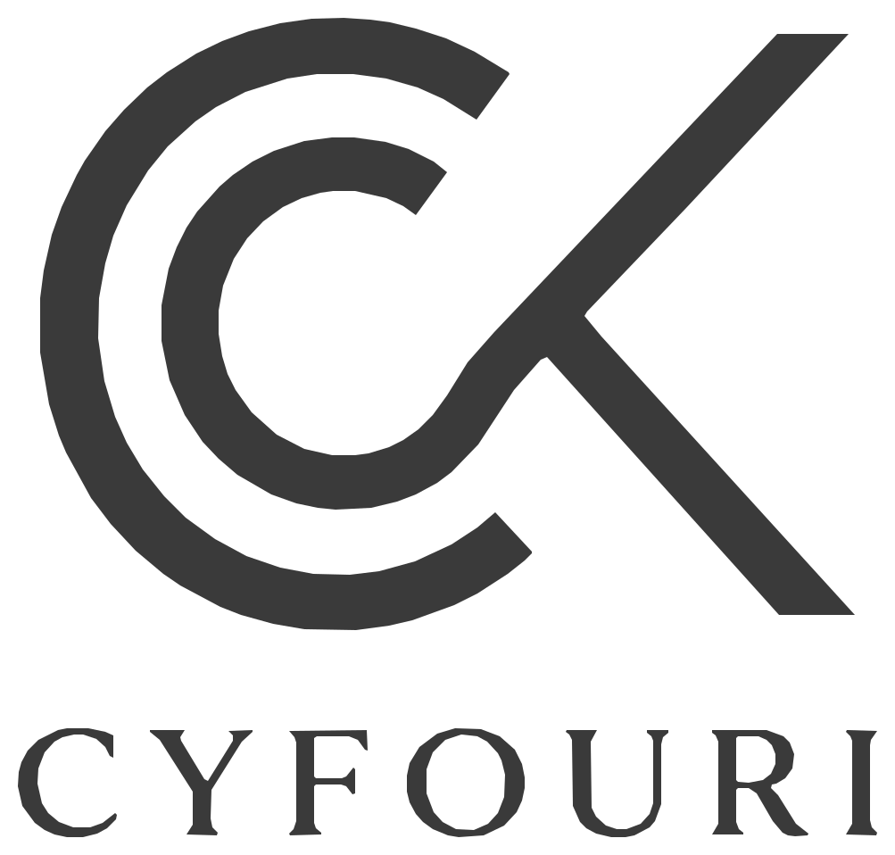
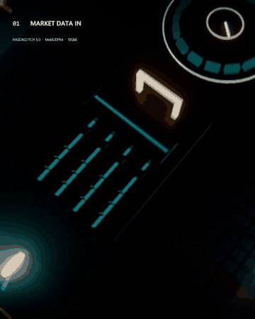
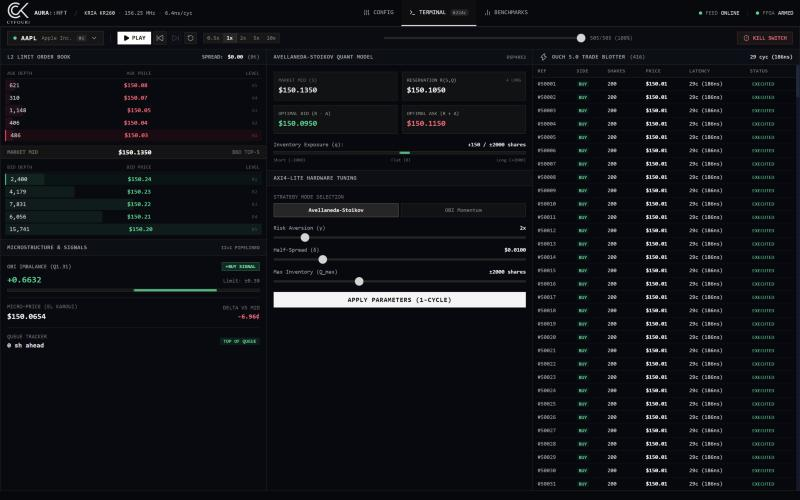

<p align="center">
  <picture>
    <source media="(prefers-color-scheme: dark)" srcset="docs/assets/cyfouri-light.svg">
    
  </picture>
</p>

# AURA-HFT

**An FPGA tick-to-trade pipeline in SystemVerilog, verified message by message against real NASDAQ data.**

NASDAQ ITCH 5.0 over MoldUDP64 → full-depth hardware order book → division-free order-book-imbalance signal → formally verified pre-trade risk → NASDAQ OUCH 5.0 orders. Target: AMD Kria KR260 (Zynq UltraScale+ `xck26`).

> **Status: cycle-accurate simulation.** There is no board in the loop yet and no Vivado timing report. Every number below links to its evidence, and the full register of public claims is [docs/CLAIMS.md](docs/CLAIMS.md).

[](https://github.com/CyrilKFOURI/aura-hft/actions/workflows/ci.yml)
[](rtl/)
[](Dockerfile)
[](LICENSE)

<p align="center">
  <a href="https://github.com/CyrilKFOURI/aura-hft/releases/latest"></a><br>
  <sub>90-second explainer rendered in Blender from <code>video/scripts/</code>. Full video: <a href="https://github.com/CyrilKFOURI/aura-hft/releases/latest">latest release</a>. It shows the 27-cycle design that preceded the registered-memory change (now 29 cycles, see C1 in <a href="docs/CLAIMS.md">CLAIMS</a>).</sub>
</p>

---

## Results

| Claim | Evidence | Status |
| :-- | :-- | :-- |
| **The RTL order book is exact on real data.** 0 divergence in best bid/ask and top-5 depth over **215,674 real NASDAQ messages** (AAPL, MSFT, TSLA, 2019-01-30, 04:00 to 09:36 ET, opening cross included). | [reports/rtl_real_cosim_01302019.md](reports/rtl_real_cosim_01302019.md) | Simulated, real data |
| **The reference model is independently checked.** Golden model vs the MeatPy library: 20 M real messages, 6 symbols, 786,626 checks, 0 divergence. | [reports/golden_vs_meatpy_01302019_first20M.md](reports/golden_vs_meatpy_01302019_first20M.md) | Proven |
| **Real network framing.** 5,000 real IEX HIST Ethernet/IPv4/UDP frames carrying 23,123 real NASDAQ messages, 0 divergence. | [reports/robustness.md](reports/robustness.md) | Simulated |
| **Fault tolerance.** 10 fault scenarios against the golden model (gaps, duplicates, truncated frames, unknown references, non-UDP frames, 1,800-message bursts). All pass after 4 RTL bugs were found and fixed. | [reports/robustness.md](reports/robustness.md) | Simulated (FCS drop still missing) |
| **Risk never lets a forbidden order out.** 6 safety properties (kill switch, max shares, price collar, max notional, saturating cumulative notional, exclusive strobes) proved by k-induction with the multiplier abstracted; 8 mutants refuted; a 64-bit wrap bug found and fixed. | [docs/CLAIMS.md](docs/CLAIMS.md) (C19), [formal/](formal/) | Proven, with abstraction |
| **Tick-to-trade: 29 cycles = 185.6 ns at 156.25 MHz**, end to end, synthetic scenario. | `sim/tests/tb_tick_to_trade_top.py` | Simulated; timing closure unproven |
| **C++ software reference path**, bit-exact with the golden model on 426,961 real events. CPU p50 126 to 189 ns, p99.9 1.6 to 8.8 µs on one laptop core, message already in memory, no network stack. | [reports/software_vs_fpga.md](reports/software_vs_fpga.md) | Measured |
| **The OBI strategy has no edge after costs.** Net PnL is negative in all 36 threshold × horizon × latency configurations on real data. | [research/obi_backtest.md](research/obi_backtest.md) | Measured (negative result) |
| Resources, Yosys estimate of the book alone (not Vivado): 47.8 k LUT, 20.8 k FF, 35 DSP, 376 BRAM36 against 144 available, so the book must map to UltraRAM. | [reports/yosys_estimate_lob_engine.md](reports/yosys_estimate_lob_engine.md) | Estimate |

**Not claimed:** silicon latency, timing closure or Fmax, a profitable strategy, regulatory compliance. The risk controls are *inspired by* SEC 15c3-5 and MiFID II RTS 6.

---

## Architecture

Reference top: [`rtl/top/aura_hft_top.sv`](rtl/top/aura_hft_top.sv), single 156.25 MHz clock (6.4 ns period).

```
 10GbE frame ─► MoldUDP64 depacketizer ─► ITCH 5.0 parser ─► 64-entry request FIFO (back-pressure)
   (FCS checker,   (gap / duplicate /       (all order types,          │
    PTP timestamp)  non-UDP drop)            frame-boundary safe)      ▼
                                                  order_store: 2-choice hash, 2×8192×4 + stash,
                                                  O(1) epoch reset, registered BRAM reads
                                                               │
                                                               ▼
                                                  depth_book: 65,536 penny ticks per side,
                                                  3-level occupancy bitmap, exact top 5
                                                               │
                              top of book ◄────────────────────┘
                                   │
            obi_signal: OBI ≥ T  ⇔  (Vb − Va)·2³¹ ≥ T·(Vb + Va)      2 cycles, no divider
                                   │
            pre_trade_risk: 2 stages (DSP product, then limits)       formally proved
                                   │
            OUCH 5.0 Enter Order ─► AXI4-Stream egress, latency metrology
```

The reasoning behind each block is in [docs/DESIGN_DECISIONS.md](docs/DESIGN_DECISIONS.md); the system design is in [docs/TRD.md](docs/TRD.md).

Modules that are tested on their own but **not** wired into the reference top live in [`rtl/experimental/`](rtl/experimental/): a dual-clock 156.25/312.5 MHz top, an Avellaneda-Stoikov quoting engine, cross-exchange arbitrage, Iceberg/TWAP execution, MoldUDP64 gap recovery and a multi-ticker top.

---

## Dashboard

A FastAPI backend drives Verilator replays and streams them to a React terminal: L2 book, signals, AXI-Lite parameter tuning and the OUCH order blotter. Latencies shown are labelled with their source (simulated FPGA vs measured CPU).



---

## Quickstart

Requirements: Python 3.11+, Node 22, and Docker for the RTL simulations (or a local Verilator ≥ 5.036 with cocotb 2.x).

```bash
pip install -r requirements.txt -r requirements-dev.txt
npm ci --prefix client

# Dashboard: backend on :8000, frontend on :5174
python -m uvicorn server.main:app
npm run dev --prefix client
```

## Tests

```bash
# Full verification in Docker (Ubuntu 24.04, Verilator 5.040, cocotb 2.0.1)
docker build -t aura-hft-ci .
docker run --rm -v "$PWD":/work aura-hft-ci make lint typecheck test

# Without Docker: golden model, backend, linters
pytest
ruff check .
mypy server
npm run typecheck --prefix client

# Formal proof of the risk properties
make docker-formal

# Replay real NASDAQ data (streams ~250 MB from NASDAQ's public sample server; never committed)
make fetch-data validate-real
python -m sim.validation.extract_symbol_stream data/cache/01302019.NASDAQ_ITCH50.first20000000.itch --symbol AAPL
REAL_STREAM=$PWD/data/cache/01302019.NASDAQ_ITCH50.first20000000.itch.AAPL.stream.json \
  pytest sim/tests/test_real_data_rtl.py

# Software reference path and backtest
make -C software/ref_pipeline test
python -m research.obi_backtest
```

CI ([.github/workflows/ci.yml](.github/workflows/ci.yml)) runs lint, typecheck, every simulation and the dashboard build on each push.

---

## What real data changed

The first version of this design looked good on synthetic traffic. Replaying a real NASDAQ day exposed the gaps:

1. **The original order book was wrong on real markets**: 83 to 97 % of messages diverged. It held 16 price levels and 2,048 orders; AAPL alone reached 2,754 levels and 39,964 live orders. The book was redesigned around those measured sizes.
2. **The original hash spread real order references badly** because it used the low bits of a multiplicative hash.
3. **Five robustness bugs** (duplicate frames re-applied, parser hang on truncated frames, silent FIFO loss in bursts, non-UDP frames parsed, 64-bit notional wrap) were found by fault injection and formal proof.
4. **The trading signal loses money after costs.** The hardware is a correct, fast execution engine, not an alpha.

## Known limits

- **Vivado:** map `order_store` and `depth_book` to UltraRAM, close timing at 156.25 MHz, commit timing and utilization reports, add the AMD 10G MAC and a store-and-forward FCS drop. Today a corrupted frame still reaches the book (`test_fcs_top.py` is a strict xfail).
- **KR260 board:** hardware-in-the-loop replay of the same captures and silicon latency with PTP timestamps.
- Fault-bench coverage is 61 % lines / 66 % branches (target 90 %).
- The strategy has no position or exit logic; it sends one order per book update while the signal holds.
- One trading day of data: pre-market and the first ~40 minutes of the session.

---

## Repository layout

```
rtl/               reference pipeline: ingress, parser, book, quant, risk, egress, control, metrology, top
rtl/experimental/  standalone experimental modules
rtl/assertions/    SVA properties and bind files
formal/            k-induction proof flow for the risk block
sim/               golden model, validation scripts, cocotb benches (synthetic, fault, real data)
software/          C++20 reference pipeline and latency benchmark
research/          OBI backtest on real data
server/            FastAPI backend: Verilator runner, replay, SQLite telemetry
client/            React + TypeScript dashboard
driver/            C++20 Linux UIO driver (host-tested; no board yet)
constraints/       KR260 pin and timing constraints
scripts/           Vivado and Yosys scripts
data/              fetch scripts for NASDAQ ITCH and IEX HIST samples (data is gitignored)
reports/           every measured result referenced above
docs/              claims register, design decisions, PRD/TRD, UI and backend notes
sources/           annotated bibliography
video/             Blender scripts for the explainer video
```

## License

[MIT](LICENSE) © 2026 Cyril Kfouri (CYFOURI)
