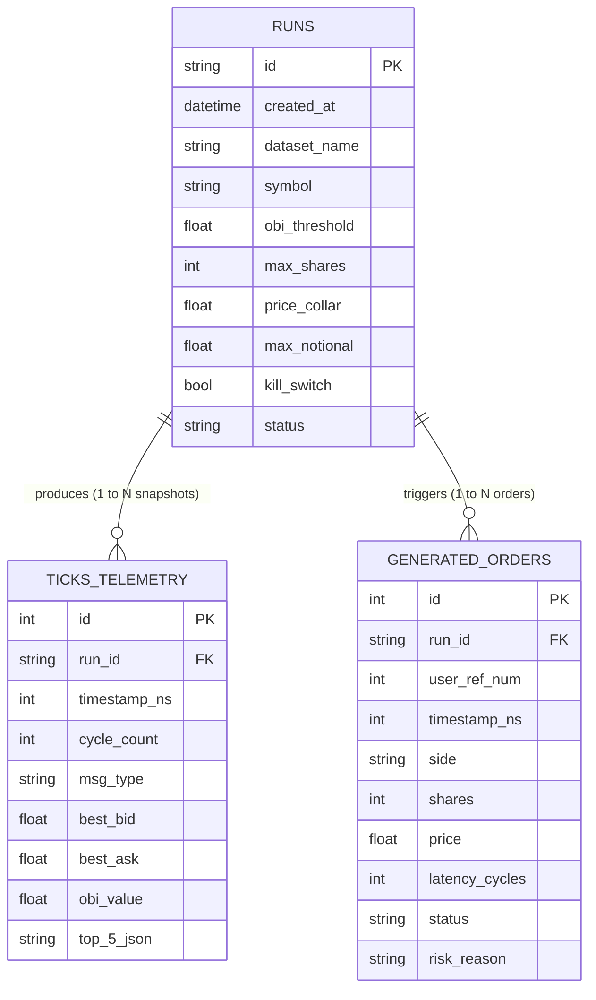

# BACKEND SCHEMA — AURA-HFT

This document specifies the data schema, storage structures and access paths used to record, collect telemetry from, and replay AURA-HFT simulations.

---

## Entities / tables

Storage is a local relational database (**SQLite 3**) in **WAL (Write-Ahead Logging)** mode, which allows fast concurrent reads during simulation writes.

### 1. Table `runs` (simulation sessions)
Stores the metadata and general configuration of each hardware run.

| Field | Type | Constraints | Description |
| :--- | :--- | :--- | :--- |
| `id` | TEXT / UUID | PRIMARY KEY | Unique run session identifier |
| `created_at` | DATETIME | NOT NULL | Launch date and time |
| `dataset_name`| TEXT | NOT NULL | Name of the ITCH feed file used (e.g. `AAPL_20241014.itch`) |
| `symbol` | TEXT | NOT NULL | Ticker symbol monitored (e.g. `AAPL`) |
| `obi_threshold`| REAL | NOT NULL | OBI trigger threshold (e.g. `0.65`) |
| `max_shares` | INTEGER | NOT NULL | Risk limit: maximum volume per order |
| `price_collar`| REAL | NOT NULL | Risk limit: maximum allowed deviation (%) |
| `max_notional`| REAL | NOT NULL | Risk limit: maximum notional exposure |
| `kill_switch` | BOOLEAN | NOT NULL | Initial kill switch state (0 = OFF, 1 = ON) |
| `status` | TEXT | NOT NULL | Status: `RUNNING`, `COMPLETED`, `FAILED` |
| `total_ticks` | INTEGER | DEFAULT 0 | Total number of ITCH messages processed |
| `total_orders`| INTEGER | DEFAULT 0 | Total number of orders generated by the FPGA |
| `p50_latency` | REAL | NULL | Measured median latency (ns) |
| `p99_latency` | REAL | NULL | Measured 99th percentile latency (ns) |

### 2. Table `ticks_telemetry` (book snapshot time series)
Records the book state and the signals emitted by the RTL on each significant update.

| Field | Type | Constraints | Description |
| :--- | :--- | :--- | :--- |
| `id` | INTEGER | PRIMARY KEY AUTOINCREMENT | Sequence identifier |
| `run_id` | TEXT | FOREIGN KEY (`runs.id`) | Reference to the run session |
| `timestamp_ns`| INTEGER | NOT NULL | Exchange timestamp in nanoseconds |
| `cycle_count` | INTEGER | NOT NULL | FPGA clock cycle counter since reset |
| `msg_type` | TEXT | NOT NULL | Triggering ITCH message type (`A`, `E`, `X`, etc.) |
| `best_bid` | REAL | NOT NULL | Current best bid price |
| `best_ask` | REAL | NOT NULL | Current best ask price |
| `bid_qty_l1` | INTEGER | NOT NULL | Aggregate volume at the best bid |
| `ask_qty_l1` | INTEGER | NOT NULL | Aggregate volume at the best ask |
| `obi_value` | REAL | NOT NULL | Imbalance value computed in fixed-point |
| `micro_price` | REAL | NOT NULL | Computed theoretical micro-price |
| `queue_pos` | INTEGER | NULL | Position of the virtual order in the queue |
| `top_5_json` | TEXT | NOT NULL | JSON snapshot of the top 5 Bid/Ask levels |

### 3. Table `generated_orders` (blotter of orders emitted by the FPGA)
Records every OUCH 5.0 order pulse generated by the hardware core.

| Field | Type | Constraints | Description |
| :--- | :--- | :--- | :--- |
| `id` | INTEGER | PRIMARY KEY AUTOINCREMENT | Identifier |
| `run_id` | TEXT | FOREIGN KEY (`runs.id`) | Reference to the run session |
| `user_ref_num`| INTEGER | NOT NULL | OUCH order number generated by the hardware |
| `timestamp_ns`| INTEGER | NOT NULL | Emission timestamp in nanoseconds |
| `side` | TEXT | NOT NULL | Order side (`B` = Bid, `S` = Ask) |
| `shares` | INTEGER | NOT NULL | Requested quantity |
| `price` | REAL | NOT NULL | Specified limit price |
| `latency_cycles`| INTEGER| NOT NULL | Exact hardware latency in clock cycles |
| `latency_ns` | REAL | NOT NULL | Equivalent latency in nanoseconds ($Cycles \times 6.4$) |
| `status` | TEXT | NOT NULL | `EXECUTED`, `REJECTED` |
| `risk_reason` | TEXT | NULL | Rejection reason (`PRICE_COLLAR`, `FAT_FINGER`, etc.) |

---

## Relationships

---

## Access rules (who reads/writes what)

1. **Simulation harness (C++/Verilator & Python wrapper):**
   * **Exclusive writer:** Inserts telemetry into `ticks_telemetry` and orders into `generated_orders` during the run, using batch inserts to preserve performance.
   * **Update:** Updates `runs` at the end of the simulation (status `COMPLETED`, global $p_{50}$ and $p_{99}$ metrics).

2. **Backend API (FastAPI):**
   * **Write:** Creates the initial `runs` record on the POST `/api/runs/launch` call.
   * **Read:** Queries `runs`, `ticks_telemetry` and `generated_orders` to serve REST requests and feed the replay WebSocket streams.

3. **Frontend dashboard (React client):**
   * **Read-only:** Consumes data through the REST API `/api/runs/:id` and the replay stream `/ws/replay/:id`.
   * **Indirect write:** Sends launch parameters through the run-creation endpoint.
