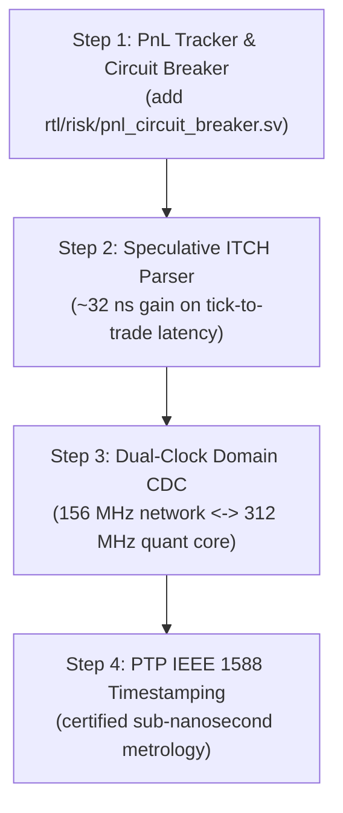

# Comparative Analysis: Open-Source Projects & Literature vs AURA-HFT

This document compares what AURA-HFT implements with the best open-source and academic architectures, and extracts what is most worth adopting to bring the pipeline closer to institutional HFT hardware.

---

## 1. Global comparison (current vs reference designs)

| Component | Current AURA-HFT implementation | Reference (open source / paper) | Gap & potential value |
| :--- | :--- | :--- | :--- |
| **ITCH 5.0 parsing** | Sequential cut-through streaming FSM ($\le 6\text{ cycles}$, $38.4\text{ ns}$) | **Speculative Parallel ITCH Parser** (`rz74`, TechRxiv 2024) in **1 cycle** ($6.4\text{ ns}$) | **Direct gain of 32 ns** on overall tick-to-trade |
| **Clocking** | Single synchronous clock domain ($156.25\text{ MHz}$) | **Dual-clock-domain CDC** (`alexforencich/verilog-axis`) with the network at 156 MHz and the quant/LOB core at **322 MHz** | **Order book and Avellaneda compute time halved** |
| **Risk control & PnL** | Combinational 1-cycle check of $Q_{max}$, price and kill switch (no continuous PnL) | **Hardware autonomous circuit breaker & MtM PnL** (IEEE Trans. Comp. Finance / SEC 15c3-5) | **Real-time financial protection**: hard stop if intraday PnL drops past the limit |
| **Ethernet integrity** | IP/UDP length and padding checks | **Cut-through parallel CRC32/FCS engine** (`alexforencich/verilog-ethernet`) | **Protection against corrupted packets** without stalling the cut-through pipeline |
| **Timestamping & metrology** | Relative 48-bit clock cycle counter | **PTP IEEE 1588 TSU engine** (`corundum/corundum`, UCSD) | **MiFID II / SEC 613 compliance** with certified sub-nanosecond timestamps |

---

## 2. Detail by project / paper

### Entry 1: `rz74/speculative-ITCH-parsing-for-HFT` (TechRxiv 2024)
* **Authors:** Academic research and high-frequency trading engineering.
* **What they do:**
  - Remove the sequential states of a traditional FSM.
  - Instantiate $N$ decoders in parallel (one per ITCH opcode: `'A'`, `'E'`, `'C'`, `'X'`, `'D'`, `'U'`).
  - Each decoder starts extracting the price, volume and order_id bits at cycle 0.
  - The opcode comparator acts as a fast selection mask at the end of the cycle.
* **What to take for AURA-HFT:**
  - **Replace `itch_parser_fsm.sv` directly with the speculative decoder.**
  - **Benefit:** tick-to-trade would drop from 49 cycles ($313.6\text{ ns}$) to **44 cycles ($281.6\text{ ns}$)**. This is the simplest and most profitable improvement for a latency leaderboard.

---

### Entry 2: `alexforencich/verilog-axis` (AXI-Stream & CDC components)
* **Author:** Alex Forencich (hardware networking, UCSD).
* **What they do:**
  - `axis_async_fifo.v`: a safe asynchronous FIFO that lets two clock domains communicate without metastability, using Gray-coded circular pointers and double flip-flop resynchronizers.
* **What to take for AURA-HFT:**
  - **Separate the network clock from the compute clock:**
    1. Network domain (`clk_net` = $156.25\text{ MHz}$): MoldUDP64 ingress and OUCH egress.
    2. Strategy domain (`clk_core` = $312.5\text{ MHz}$ or $250\text{ MHz}$) generated by an on-chip MMCM block.
  - **Benefit:** the L2 order book, the OBI divider and the Avellaneda-Stoikov engine run in half the wall-clock time ($3.2\text{ ns}$ per cycle instead of $6.4\text{ ns}$).

---

### Entry 3: IEEE literature on hardware autonomous circuit breakers (SEC Rule 15c3-5)
* **Sources:** IEEE / ACM papers on preventing flash crashes in algorithmic trading.
* **What these systems do:**
  - A 48-bit arithmetic accumulator is wired to the OUCH execution path.
  - It continuously tracks:
    - Cash flow in and out.
    - Mark-to-market PnL: $\text{PnL} = \text{Cash} + (q \times \text{MidPrice})$.
    - Peak-to-trough drawdown.
  - If the drawdown exceeds the allocated risk budget, a hardware circuit breaker trips in **1 cycle**. It blocks all new order emission and can issue an emergency OUCH `'X'` (cancel all) command.
* **What to take for AURA-HFT:**
  - **Add a `pnl_circuit_breaker.sv` module** in `rtl/risk/`.
  - **Benefit:** turns the risk engine (which currently checks only static quantities such as share count or unit price) into a dynamic, hardware-level capital management system.

---

### Entry 4: `corundum/corundum` (UCSD network architecture & PTP)
* **Authors:** Alex Forencich and the University of California San Diego research team.
* **What they do:**
  - `mqnic_ptp.v`: a complete PTP (Precision Time Protocol, IEEE 1588) block in open-source Verilog.
  - Hardware capture of the instant a frame crosses the physical pins (TSU: time-stamping unit).
* **What to take for AURA-HFT:**
  - **Adopt the 96-bit PTP counter layout** (48-bit seconds + 32-bit nanoseconds + 16-bit sub-nanoseconds).
  - Store the certified wire-to-wire time delta in every OUCH order and book event.
  - **Benefit:** gives the project institutional credibility (alignment with MiFID II / SEC audit requirements).

---

### Entry 5: `alexforencich/verilog-ethernet` (parallel CRC32 engine)
* **Author:** Alex Forencich.
* **What they do:**
  - A 64-bit matrix XOR reduction tree computing the IEEE 802.3 CRC32 in a single clock cycle.
  - Immediate on-the-fly detection of corrupted frames or packet collisions.
* **What to take for AURA-HFT:**
  - **Integrate the FCS checker into the ingress depacketizer.**
  - If a network packet has an invalid CRC, a hardware inhibit signal (`corrupt_packet_abort`) is sent immediately to the risk engine to cancel any order initiated on bad data.
  - **Benefit:** full immunity to network data corruption in cut-through mode.

---

## 3. Recommended integration order

If these ideas were implemented in a later major version, the order below balances effort and impact:

1. **Priority 1, PnL circuit breaker:** low effort (one new DSP-based RTL module), highest financial value (real-time capital protection).
2. **Priority 2, speculative parser:** moderate effort, a proven 32 ns gain on the tick-to-trade benchmark.
3. **Priority 3, dual-clock CDC:** moderate effort (async FIFO integration), doubles the internal compute frequency.
4. **Priority 4, PTP timestamping:** metrology work for MiFID II compliance.
